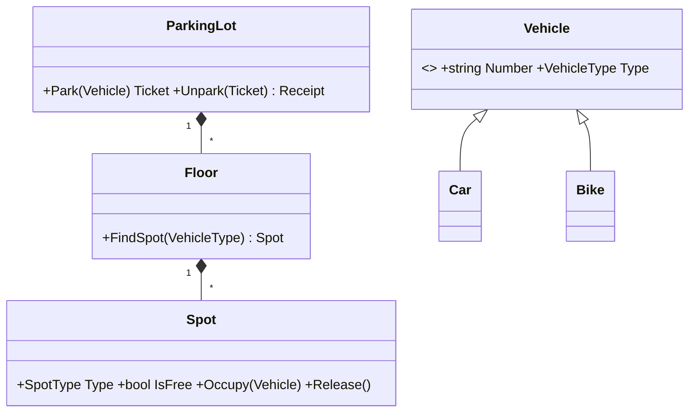
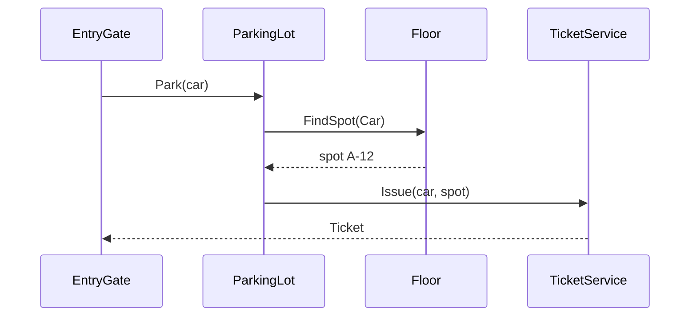

# Overview

**Low-Level Design** (also called object-oriented design or machine coding) answers: *which classes, interfaces, methods and relationships implement this feature cleanly?* It sits between HLD (boxes and arrows) and code.

| HLD | LLD |
|---|---|
| Services, databases, caches, queues | Classes, interfaces, enums, methods |
| Scale, availability, data distribution | Responsibilities, extensibility, patterns, testability |
| Diagrams: architecture | Diagrams: UML class and sequence |
| "Booking service talks to Payment service via a queue" | "`BookingService.Book()` uses `ISeatLockProvider` and `IPaymentGateway`" |

Interviewers check: clear entities, single responsibilities, use of interfaces, correct relationships (composition vs inheritance), sensible patterns (Strategy, Factory, State, Observer, Singleton used correctly), handling of edge cases and concurrency, and working code.

# Versions

| Year | Milestone |
|---|---|
| 1967–1980 | Simula and Smalltalk introduce objects and classes |
| 1994 | *Design Patterns* by the Gang of Four (23 patterns) |
| 1997 | UML 1.1 standardised by the OMG (Booch, Rumbaugh, Jacobson) |
| 2000 | SOLID principles described by Robert C. Martin |
| 2003 | *Domain-Driven Design* (Eric Evans) |
| 2005 | UML 2.0 |
| 2010s | "Machine coding" rounds become common at product companies |
| 2020s | LLD + HLD rounds standard for senior developer interviews |

# Lifecycle

**LLD interview approach (45–60 minutes):**

1. **Clarify requirements** — list use cases; agree on scope (e.g. "parking lot: multiple floors, vehicle types, tickets, payment; no reservations").
2. **Identify entities (nouns)** — Vehicle, Spot, Floor, Ticket, Payment…
3. **Identify behaviours (verbs)** — park, unpark, calculate fee, pay.
4. **Define relationships** — has-a (composition/aggregation), is-a (inheritance), uses (dependency).
5. **Draw a class diagram** — classes, key fields, methods, interfaces, enums.
6. **Apply principles & patterns** — SOLID, Strategy for varying rules, Factory for creation, State for lifecycles, Observer for notifications.
7. **Write code** for the core flow; keep it compilable and readable.
8. **Discuss** extensibility (new vehicle type?), concurrency (two cars, one spot), testing, and persistence (tables).

# Tools

- **UML:** draw.io, PlantUML, Mermaid (class/sequence diagrams in Markdown), Visual Studio class designer, Lucidchart.
- **Code:** Visual Studio / Rider / VS Code with C#; xUnit for quick tests.
- **Reading:** *Head First Design Patterns*, refactoring.guru (patterns with C# examples), *Clean Architecture*.

# Module: Foundations of Object Design

## Lesson: [Basic|High] From requirements to classes — nouns, verbs and responsibilities

**Technique:** write the use cases as sentences, underline nouns (candidate classes) and verbs (methods), then assign each responsibility to the class that owns the data it needs (**Information Expert**).

Example — *"A member borrows a book copy from the library; the system records the due date and charges a fine if it is returned late."*

| Nouns → classes | Verbs → methods | Owner |
|---|---|---|
| Member, Book, BookCopy, Library, Loan, Fine | borrow, return, record due date, charge fine | `Library.Borrow(member, copy)` creates a `Loan`; `Loan.Return(date)` computes overdue days; `IFinePolicy.Calculate(loan)` gives the amount |

Guidelines:

- Each class has **one reason to change** (SRP).
- Prefer **composition** ("has-a") over inheritance; inherit only for true "is-a" with shared behaviour.
- Depend on **interfaces** for things that vary (payment methods, pricing rules, notification channels).
- Use **enums** for fixed sets of states/types; use **State/Strategy** when behaviour differs per state/type.
- Make invalid states impossible (private setters, constructor validation, value objects like `Money`).

## Lesson: [Basic|High] UML class diagrams and sequence diagrams

**Class diagram notation:**

| Symbol | Meaning | Example |
|---|---|---|
| `+` / `-` / `#` | public / private / protected | `+Park(vehicle): Ticket` |
| Solid line + hollow triangle | Inheritance (is-a) | `Car ──▷ Vehicle` |
| Dashed line + hollow triangle | Implements interface | `UpiPayment ┈┈▷ IPayment` |
| Filled diamond | **Composition** — part can't exist without the whole | `Floor ◆── Spot` |
| Hollow diamond | **Aggregation** — part can exist independently | `Team ◇── Player` |
| Plain arrow | Association / dependency | `Ticket ──> Spot` |
| `1`, `0..1`, `*`, `1..*` | Multiplicity | `ParkingLot 1 ── * Floor` |



**Sequence diagram** — the order of calls between objects for one use case:



## Lesson: [Intermediate|High] Applying SOLID and design patterns in LLD

| Situation in a design | Pattern | Example |
|---|---|---|
| Behaviour varies by type/rule and can be swapped | **Strategy** | Fee calculation per vehicle type; payment methods; pricing |
| Creating objects depends on input | **Factory** / Abstract Factory | `VehicleFactory.Create("CAR", number)` |
| Object behaves differently in each lifecycle state | **State** | Vending machine (Idle → HasMoney → Dispensing), order status |
| Notify many parts when something happens | **Observer** | Display boards update when spots change; notify users |
| Exactly one shared instance | **Singleton** (prefer DI singleton lifetime) | `ParkingLot` instance, configuration |
| Add features without changing a class | **Decorator** | Add-ons to a pizza/coffee price; logging around a service |
| Step-by-step construction of complex objects | **Builder** | Building a `Booking` or HTTP request |
| Chain of handlers each deciding to handle or pass on | **Chain of Responsibility** | ATM cash dispenser (2000 → 500 → 100 notes), approval workflows |
| Encapsulate a request as an object | **Command** | Undo/redo, queued elevator requests |
| Simplify a complex subsystem | **Facade** | `BookingFacade` hides seats, payment, notifications |

```csharp
// Strategy + Open/Closed: add a new vehicle fee rule without touching existing code
public interface IFeeStrategy { decimal Calculate(TimeSpan duration); }
public sealed class CarFee : IFeeStrategy { public decimal Calculate(TimeSpan d) => 40 + Math.Max(0, Math.Ceiling(d.TotalHours) - 1) * 30; }
public sealed class BikeFee : IFeeStrategy { public decimal Calculate(TimeSpan d) => 20 + Math.Max(0, Math.Ceiling(d.TotalHours) - 1) * 10; }

public sealed class FeeCalculator(IReadOnlyDictionary<VehicleType, IFeeStrategy> strategies)
{
    public decimal For(VehicleType type, TimeSpan duration) => strategies[type].Calculate(duration);
}
```

# Module: Classic LLD Problems

## Lesson: [Intermediate|High] Design a parking lot

**Requirements:** multiple floors; spot types (Bike, Compact, Large); vehicles (Bike, Car, Truck); entry issues a ticket; exit calculates the fee by type and duration; show free spots; thread-safe allocation.

```csharp
public enum VehicleType { Bike, Car, Truck }
public enum SpotType { Bike, Compact, Large }

public abstract record Vehicle(string Number, VehicleType Type);
public sealed record Car(string Number) : Vehicle(Number, VehicleType.Car);
public sealed record Bike(string Number) : Vehicle(Number, VehicleType.Bike);
public sealed record Truck(string Number) : Vehicle(Number, VehicleType.Truck);

public sealed class Spot(string id, SpotType type)
{
    public string Id { get; } = id;
    public SpotType Type { get; } = type;
    public Vehicle? Vehicle { get; private set; }
    public bool IsFree => Vehicle is null;
    public void Occupy(Vehicle v) => Vehicle = IsFree ? v : throw new InvalidOperationException($"Spot {Id} is taken");
    public void Release() => Vehicle = null;
}

public sealed class Floor(int number, IEnumerable<Spot> spots)
{
    public int Number { get; } = number;
    private readonly List<Spot> _spots = spots.ToList();
    public Spot? FindFree(SpotType type) => _spots.FirstOrDefault(s => s.IsFree && s.Type == type);
    public int FreeCount(SpotType type) => _spots.Count(s => s.IsFree && s.Type == type);
}

public sealed record Ticket(Guid Id, Vehicle Vehicle, Spot Spot, DateTime EntryUtc);

public sealed class ParkingLot(IEnumerable<Floor> floors, FeeCalculator fees, TimeProvider clock)
{
    private readonly List<Floor> _floors = floors.ToList();
    private readonly Dictionary<Guid, Ticket> _active = [];
    private readonly Lock _gate = new();                       // C# 13 System.Threading.Lock

    private static SpotType SpotFor(VehicleType t) => t switch
    {
        VehicleType.Bike => SpotType.Bike,
        VehicleType.Car => SpotType.Compact,
        _ => SpotType.Large
    };

    public Ticket Park(Vehicle v)
    {
        lock (_gate)                                          // two gates can't grab the same spot
        {
            var spot = _floors.Select(f => f.FindFree(SpotFor(v.Type))).FirstOrDefault(s => s != null)
                       ?? throw new InvalidOperationException("Parking full for " + v.Type);
            spot.Occupy(v);
            var ticket = new Ticket(Guid.NewGuid(), v, spot, clock.GetUtcNow().UtcDateTime);
            _active[ticket.Id] = ticket;
            return ticket;
        }
    }

    public decimal Unpark(Guid ticketId)
    {
        lock (_gate)
        {
            if (!_active.Remove(ticketId, out var t)) throw new KeyNotFoundException("Unknown ticket");
            t.Spot.Release();
            return fees.For(t.Vehicle.Type, clock.GetUtcNow().UtcDateTime - t.EntryUtc);
        }
    }
}
```

Discussion points: Strategy for fees (new pricing without changing `ParkingLot`), `TimeProvider` for testable time, lock (or per-spot compare-and-swap) for concurrency, Observer to update display boards, persistence tables `Spots`, `Tickets`, `Payments`.

## Lesson: [Intermediate|High] Design a library management system

**Requirements:** books with many copies; members borrow (max 5) and return; due date 14 days; fines for late returns; reservations when no copy is free; search by title/author.

```csharp
public sealed class Book(string isbn, string title, string author) { public string Isbn = isbn, Title = title, Author = author; }
public enum CopyStatus { Available, Loaned, Reserved, Lost }
public sealed class BookCopy(string barcode, Book book) { public string Barcode = barcode; public Book Book = book; public CopyStatus Status = CopyStatus.Available; }
public sealed class Member(int id, string name) { public int Id = id; public string Name = name; public List<Loan> Loans { get; } = []; }

public sealed class Loan(BookCopy copy, Member member, DateOnly borrowed)
{
    public BookCopy Copy { get; } = copy;
    public Member Member { get; } = member;
    public DateOnly Borrowed { get; } = borrowed;
    public DateOnly Due => Borrowed.AddDays(14);
    public DateOnly? Returned { get; private set; }
    public int OverdueDays(DateOnly today) => Math.Max(0, (Returned ?? today).DayNumber - Due.DayNumber);
    public void Close(DateOnly date) => Returned = date;
}

public interface IFinePolicy { decimal Fine(Loan loan, DateOnly today); }
public sealed class PerDayFine(decimal perDay) : IFinePolicy { public decimal Fine(Loan l, DateOnly t) => l.OverdueDays(t) * perDay; }

public sealed class LibraryService(IFinePolicy fines, INotifier notifier)
{
    private const int MaxLoans = 5;
    public Loan Borrow(Member m, BookCopy c, DateOnly today)
    {
        if (m.Loans.Count(l => l.Returned is null) >= MaxLoans) throw new InvalidOperationException("Loan limit reached");
        if (c.Status != CopyStatus.Available) throw new InvalidOperationException("Copy not available");
        c.Status = CopyStatus.Loaned;
        var loan = new Loan(c, m, today);
        m.Loans.Add(loan);
        return loan;
    }
    public decimal Return(Loan loan, DateOnly today)
    {
        loan.Close(today);
        loan.Copy.Status = CopyStatus.Available;
        notifier.NotifyNextReservation(loan.Copy.Book);      // Observer-style hook for reservations
        return fines.Fine(loan, today);
    }
}
public interface INotifier { void NotifyNextReservation(Book book); }
```

Tables: `Books(Isbn PK)`, `BookCopies(Barcode PK, Isbn FK, Status)`, `Members`, `Loans(Id, Barcode FK, MemberId FK, Borrowed, Due, Returned)`, `Reservations`, `Fines`.

## Lesson: [Advanced|High] Design an elevator system and a vending machine (State pattern)

**Elevator:** N elevators, requests from floors (up/down) and inside cars; a dispatcher assigns requests; each elevator moves in a direction serving stops in order (SCAN/"elevator algorithm").

```csharp
public enum Direction { Idle, Up, Down }

public sealed class Elevator(int id)
{
    public int Id { get; } = id;
    public int Floor { get; private set; }
    public Direction Direction { get; private set; } = Direction.Idle;
    private readonly SortedSet<int> _up = [], _down = [];

    public void AddStop(int floor) { if (floor >= Floor) _up.Add(floor); else _down.Add(floor); if (Direction == Direction.Idle) Direction = floor >= Floor ? Direction.Up : Direction.Down; }

    public void Step()                                         // called on each tick
    {
        if (Direction == Direction.Up && _up.Count > 0) { Floor = _up.Min; _up.Remove(Floor); }
        else if (Direction == Direction.Down && _down.Count > 0) { Floor = _down.Max; _down.Remove(Floor); }
        Direction = _up.Count > 0 ? Direction.Up : _down.Count > 0 ? Direction.Down : Direction.Idle;
    }
    public int Cost(int floor) => Math.Abs(Floor - floor) + (Direction == Direction.Idle ? 0 : 2);
}

public interface IDispatchStrategy { Elevator Choose(IReadOnlyList<Elevator> elevators, int floor); }
public sealed class NearestElevator : IDispatchStrategy
{
    public Elevator Choose(IReadOnlyList<Elevator> e, int floor) => e.MinBy(x => x.Cost(floor))!;
}
```

**Vending machine with the State pattern** — behaviour depends on the current state; each state class handles the actions:

```csharp
public interface IVendingState
{
    void InsertCoin(VendingMachine m, decimal amount);
    void SelectProduct(VendingMachine m, string code);
}

public sealed class IdleState : IVendingState
{
    public void InsertCoin(VendingMachine m, decimal amount) { m.Balance += amount; m.State = new HasMoneyState(); }
    public void SelectProduct(VendingMachine m, string code) => Console.WriteLine("Insert money first");
}

public sealed class HasMoneyState : IVendingState
{
    public void InsertCoin(VendingMachine m, decimal amount) => m.Balance += amount;
    public void SelectProduct(VendingMachine m, string code)
    {
        var p = m.Inventory[code];
        if (p.Stock == 0) { Console.WriteLine("Sold out"); return; }
        if (m.Balance < p.Price) { Console.WriteLine($"Insert {p.Price - m.Balance} more"); return; }
        p.Stock--; m.Balance -= p.Price;
        Console.WriteLine($"Dispensed {p.Name}, change {m.Balance}");
        m.Balance = 0; m.State = new IdleState();
    }
}

public sealed class Product(string name, decimal price, int stock) { public string Name = name; public decimal Price = price; public int Stock = stock; }
public sealed class VendingMachine
{
    public IVendingState State { get; set; } = new IdleState();
    public decimal Balance { get; set; }
    public Dictionary<string, Product> Inventory { get; } = [];
    public void InsertCoin(decimal amount) => State.InsertCoin(this, amount);
    public void Select(string code) => State.SelectProduct(this, code);
}
```

## Lesson: [Advanced|High] Design an LRU cache and a rate limiter

**LRU cache — O(1) get and put** (dictionary + doubly linked list):

```csharp
public sealed class LruCache<TKey, TValue>(int capacity) where TKey : notnull
{
    private readonly Dictionary<TKey, LinkedListNode<(TKey Key, TValue Value)>> _map = [];
    private readonly LinkedList<(TKey Key, TValue Value)> _order = new();   // front = most recent
    private readonly Lock _lock = new();

    public bool TryGet(TKey key, out TValue value)
    {
        lock (_lock)
        {
            if (_map.TryGetValue(key, out var node))
            {
                _order.Remove(node); _order.AddFirst(node);        // mark as recently used
                value = node.Value.Value; return true;
            }
            value = default!; return false;
        }
    }

    public void Put(TKey key, TValue value)
    {
        lock (_lock)
        {
            if (_map.TryGetValue(key, out var existing)) _order.Remove(existing);
            else if (_map.Count == capacity) { _map.Remove(_order.Last!.Value.Key); _order.RemoveLast(); }   // evict least recent
            _map[key] = _order.AddFirst((key, value));
        }
    }
}
```

**Token-bucket rate limiter per user:**

```csharp
public sealed class TokenBucket(int capacity, double refillPerSecond, TimeProvider clock)
{
    private double _tokens = capacity;
    private DateTimeOffset _last = clock.GetUtcNow();
    private readonly Lock _lock = new();

    public bool TryTake()
    {
        lock (_lock)
        {
            var now = clock.GetUtcNow();
            _tokens = Math.Min(capacity, _tokens + (now - _last).TotalSeconds * refillPerSecond);
            _last = now;
            if (_tokens < 1) return false;
            _tokens -= 1; return true;
        }
    }
}

public sealed class RateLimiter(Func<TokenBucket> create)
{
    private readonly ConcurrentDictionary<string, TokenBucket> _buckets = new();
    public bool Allow(string userId) => _buckets.GetOrAdd(userId, _ => create()).TryTake();
}
```

In production use ASP.NET Core's built-in `AddRateLimiter` or Redis for limits shared across servers — but interviewers want to see that you can build it.

## Lesson: [Advanced|Medium] Design expense sharing (Splitwise) and movie ticket booking

**Expense sharing:** users, groups, expenses split equally/exactly/by percentage (Strategy), balances between pairs, "simplify debts".

```csharp
public interface ISplitStrategy { Dictionary<string, decimal> Split(decimal amount, IReadOnlyList<string> users, IReadOnlyList<decimal>? values); }
public sealed class EqualSplit : ISplitStrategy
{
    public Dictionary<string, decimal> Split(decimal amount, IReadOnlyList<string> users, IReadOnlyList<decimal>? _)
    {
        var share = Math.Round(amount / users.Count, 2);
        var result = users.ToDictionary(u => u, _ => share);
        result[users[0]] += amount - share * users.Count;        // put rounding remainder on the first user
        return result;
    }
}

public sealed class Ledger
{
    private readonly Dictionary<(string From, string To), decimal> _owes = [];
    public void AddExpense(string paidBy, Dictionary<string, decimal> shares)
    {
        foreach (var (user, amount) in shares.Where(s => s.Key != paidBy))
            _owes[(user, paidBy)] = _owes.GetValueOrDefault((user, paidBy)) + amount;
    }
    public decimal NetBalance(string user) =>
        _owes.Where(o => o.Key.To == user).Sum(o => o.Value) - _owes.Where(o => o.Key.From == user).Sum(o => o.Value);
}
```

**Movie ticket booking (BookMyShow):** entities Movie, Theatre, Screen, Seat, Show, Booking, Payment. The hard part is **seat locking**: when a user selects seats, lock them for e.g. 10 minutes; confirm on payment or release on timeout; two users must never book the same seat.

```csharp
public interface ISeatLockProvider
{
    bool TryLock(Guid showId, IReadOnlyList<string> seats, string userId, TimeSpan ttl);   // atomic all-or-nothing
    void Unlock(Guid showId, IReadOnlyList<string> seats, string userId);
    bool IsLockedBy(Guid showId, string seat, string userId);
}
// Implementation: in-memory with a lock for one server; Redis SET NX PX per seat or a DB unique constraint on (ShowId, SeatId) for many servers.
```

Flow: `GetAvailableSeats(show)` → `TryLock(seats)` → create Booking (Pending) → payment → `Confirm` (Booked, unique row per seat) or release on failure/timeout.

# Interview

## [Beginner|High] How do you approach an LLD question?

Clarify requirements and scope → list use cases → find entities (nouns) and behaviours (verbs) → define relationships (composition, inheritance, interfaces) → draw a class diagram → apply SOLID and suitable patterns (Strategy, State, Factory, Observer) → write code for the main flows → discuss edge cases, concurrency, extensibility, testing and persistence.

## [Beginner|High] Composition vs inheritance — which do you prefer in LLD and why?

Prefer composition ("has-a") because it keeps classes small and flexible: behaviour can be swapped at runtime via interfaces (Strategy) and changes don't ripple through a hierarchy. Use inheritance only for genuine "is-a" relationships with shared behaviour and substitutability (Liskov). Deep inheritance trees become rigid and fragile.

## [Beginner|High] Explain association, aggregation and composition with examples.

Association: objects know/use each other (Teacher ↔ Student). Aggregation: whole–part where the part can exist independently (Team has Players; players exist without the team) — hollow diamond. Composition: strong ownership where the part's lifetime depends on the whole (House has Rooms; Order has OrderLines) — filled diamond.

## [Intermediate|High] Design a parking lot — what are the key classes and patterns?

ParkingLot (facade/singleton via DI) composed of Floors composed of Spots; Vehicle hierarchy (Car, Bike, Truck) or a type enum; Ticket; FeeCalculator with Strategy per vehicle type; optional Observer for display boards; Factory for vehicles. Concurrency: lock or atomic spot allocation so two gates can't take one spot. Extensibility: new vehicle/spot types and pricing rules without modifying existing classes.

## [Intermediate|High] When do you use the State pattern? Give an LLD example.

When an object's behaviour changes with its internal state and you'd otherwise have large switch statements on state. Each state is a class implementing the same interface; the context delegates to the current state, and states trigger transitions. Examples: vending machine (Idle, HasMoney, Dispensing, SoldOut), order lifecycle, ATM, elevator, document approval.

## [Intermediate|High] How do you handle concurrency in an LLD (e.g. seat booking)?

Identify shared mutable state and make the critical operation atomic: locks around allocation in a single process, atomic compare-and-set (`Interlocked`, `ConcurrentDictionary.TryAdd`), optimistic concurrency (row version) or unique constraints in the database, distributed locks with TTL (Redis `SET NX PX`) across servers. Seat booking: temporary locks with expiry, confirm on payment, unique (ShowId, SeatId) constraint as the final guarantee.

## [Intermediate|Medium] What UML diagrams are useful in LLD interviews?

Class diagrams (classes, attributes, methods, interfaces, relationships, multiplicities) and sequence diagrams (order of calls between objects for a use case). Sometimes state diagrams (lifecycle of an order/elevator) and activity diagrams. Keep them simple and focused on the core flow.

## [Intermediate|Medium] How would you make your design extensible for new requirements?

Program to interfaces, isolate what varies (Strategy for rules, Factory for creation, Observer for notifications, Decorator for add-ons), keep classes small with single responsibilities, use dependency injection, avoid type switches spread across the code (Open/Closed), and keep domain logic independent of UI/database so it can be tested and reused.

## [Advanced|High] Design an LRU cache with O(1) operations.

A hash map from key to a node in a doubly linked list ordered by recency. Get: find the node via the map, move it to the front, return the value. Put: if present, update and move to front; otherwise insert at the front, and if capacity is exceeded remove the tail node and its map entry. Add a lock for thread safety. In C#: `Dictionary<K, LinkedListNode<(K,V)>>` + `LinkedList<(K,V)>`.

## [Advanced|Medium] How do you design an elevator system?

Classes: ElevatorSystem/Controller, Elevator (current floor, direction, stop queues), Request (floor, direction), Button/Panel, Dispatcher with a strategy (nearest car, least load, zone-based). Each elevator serves stops in its current direction (SCAN) before reversing. Use the State pattern for Moving/Stopped/Maintenance, Command for requests, and simulate movement with ticks; handle emergency stop and overweight.

## [Intermediate|High] Design an ATM cash dispenser. Which pattern fits?

Chain of Responsibility: handlers for ₹2000, ₹500, ₹200 and ₹100 notes; each dispenses as many notes as it can (`amount / denomination`, limited by its stock) and passes the remainder to the next handler; if a remainder is left at the end, the request fails and nothing is dispensed (check first, then commit). Around it: ATM with the State pattern (Idle → CardInserted → Authenticated → Transaction), a BankService interface for balance/debit, and transaction logging.

## [Intermediate|Medium] How would you design a notification module that supports email, SMS and push, and new channels later?

An `INotificationChannel` interface (`SendAsync(recipient, message)`) with one class per channel (Strategy); a factory or DI registration resolves channels by user preferences; a `NotificationService` builds messages from templates and sends to each selected channel; Observer/event hooks trigger notifications from domain events (OrderShipped). New channels (WhatsApp) = a new class + registration (Open/Closed). Add retries and a queue for reliability.

## [Intermediate|Medium] How do you map an LLD class model to database tables?

Each entity with identity becomes a table with a primary key; value objects become columns (or owned types); one-to-many → foreign key on the "many" side; many-to-many → junction table; inheritance → table-per-hierarchy with a discriminator column (simple, fast) or table-per-type (normalised); enums stored as int/string; add unique constraints for business rules (one booking per seat per show) and indexes for the main queries.

## [Advanced|Medium] What makes a design "good" in an LLD interview?

Correctly modelled entities and relationships, small cohesive classes with clear names, dependencies on interfaces for varying behaviour, appropriate (not excessive) patterns, valid states enforced by constructors/methods, handled edge cases and concurrency, testable code (inject time, randomness, external services), and the ability to explain trade-offs and how new requirements fit without rewriting.

## [Scenario|High] In a machine-coding round you have 90 minutes to build a working Splitwise. How do you plan your time?

10 min: requirements and class diagram (User, Group, Expense, Split strategies, Ledger/BalanceSheet). 50 min: implement core — add expense with equal/exact/percent split (Strategy), update pairwise balances, show balances per user, validation (percentages sum to 100, exact amounts sum to total). 20 min: simplify debts (greedy matching of max creditor and max debtor), simple console/driver and a few unit tests. 10 min: refactor names, handle rounding, explain extensions (currencies, persistence, notifications).

## [Scenario|Medium] Your parking-lot design uses `if (vehicle is Car) ... else if (vehicle is Bike) ...` in five places. The interviewer adds "electric cars with charging spots". What do you change?

The type checks violate Open/Closed — every new type edits five places. Move varying behaviour behind abstractions: a spot-type mapping/strategy per vehicle type, fee strategies registered in a dictionary/DI, and a `ChargingSpot` type with its own pricing (Decorator/Strategy for charging cost). Adding electric cars then means adding new classes and registering them, not modifying existing logic.

# Cheatsheet

## LLD steps

Requirements → use cases → nouns/verbs → relationships → class diagram → SOLID + patterns → code core flow → concurrency, edge cases, tests, tables.

## Pattern picker

Varying rule → Strategy · lifecycle states → State · object creation → Factory/Builder · notify many → Observer · add features → Decorator · pass along handlers → Chain of Responsibility · undo/queue requests → Command · simple front door → Facade · one instance → DI singleton.

## UML quick key

`+` public `-` private `#` protected · ▷ inheritance · ┈▷ interface · ◆ composition · ◇ aggregation · multiplicities 1, 0..1, *, 1..*.

## Classic problems

Parking lot · library · elevator · vending machine · ATM (chain of note dispensers) · LRU cache · rate limiter · Splitwise · movie booking (seat locks) · snake & ladder · chess · hotel booking · food delivery.

## Concurrency in LLD

Lock critical sections · atomic ops (`Interlocked`, `ConcurrentDictionary.TryAdd`) · optimistic concurrency (row version) · unique constraints · distributed locks with TTL · idempotent operations.
